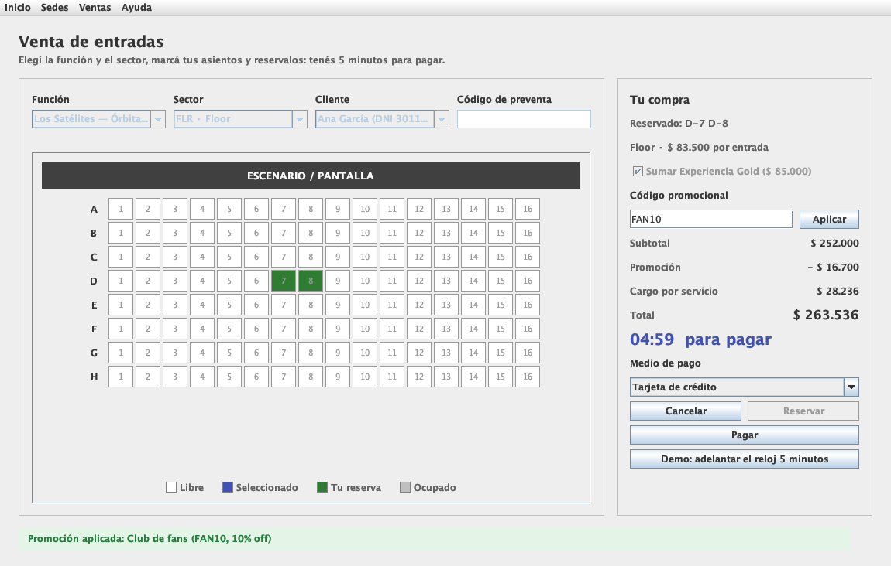

# Boletería — TPO Paradigma Orientado a Objetos · UADE 2026 · Grupo 3

Sistema de venta de entradas para sedes de espectáculos, inspirado en la **Esfera de Las Vegas**:
el precio de cada ubicación depende del piso y de la distancia al escenario, los asientos se reservan
por 5 minutos mientras se paga, hay preventa con código de acceso, promociones por código, factura y devoluciones.



> **Para defenderlo:** [DEFENSA.md](DEFENSA.md) explica por qué el sistema está diseñado así: capas MVC, cada patrón, excepciones, relaciones y preguntas probables.

## Equipo

| Integrante |
|---|
| Aded, Fermín |
| Ávila, Tomás |
| Vázquez, Daniel |
| Villa Abrille, Malena |

## Estructura del repositorio

```
paradigma_tpo_2026/
├── boleteria/                 Proyecto Java (Maven, Java 17)
│   ├── src/main/java/...      Código fuente (paquete ar.edu.uade.poo.grupo3.tpo: vista / controlador / modelo)
│   ├── datos/                 Archivos .txt donde se guardan sedes, sectores y cuentas
│   ├── Boleteria-TPO.jar      Aplicación compilada, lista para ejecutar
│   ├── Ejecutar Boleteria.command   Doble click en Mac para abrirla
│   └── README.md              Cómo ejecutar, patrones, excepciones y archivos
├── diagramas/
│   ├── clases/                Diagrama de clases v3 (diseño acotado) y v4 (igual al código)
│   ├── arquitectura/          Las tres capas de MVC: vista, controlador y modelo
│   └── flujo-de-compra/       Secuencia de compra y devolución, estados de Compra y Entrada
├── entregas/
│   ├── entrega-1/             Propuesta de negocio + diagrama preliminar (entregado)
│   └── entrega-2/             Qué pide la entrega 2 y dónde está cada cosa
└── capturas/                  Capturas de todas las pantallas
```

## Cómo ejecutarlo

Requiere **Java 17 o superior**. Desde la carpeta `boleteria/`:

```bash
java -jar Boleteria-TPO.jar                 # aplicación Swing
mvn compile exec:java                       # lo mismo, compilando con Maven
mvn compile exec:java -Dexec.mainClass=ar.edu.uade.poo.grupo3.tpo.DemoFlujoCompra   # demo por consola
```

En Mac también se puede hacer doble click en `boleteria/Ejecutar Boleteria.command`.

Datos de prueba: cuentas `ana@mail.com`, `bruno@mail.com`, `carla@mail.com` (contraseña `boleteria123`) ·
preventa `ORBITA26` · promociones `FAN10` (10 %) y `BANCO20` (20 %).

## Funcionalidades

| Área | Qué hace |
|---|---|
| **Interfaz** | Swing con componentes estándar: una sola ventana con menú (Inicio · Sedes · Ventas · Ayuda, con atajos de teclado) y las pantallas como tarjetas; avisos en la misma pantalla y 3 diálogos (confirmar baja, error de arranque, comprobante) |
| **ABM de sedes** | Consulta, alta, modificación y baja de sedes y sus sectores (numerados con filas y asientos, o generales con capacidad) |
| **Venta de entradas** | Mapa de asientos con escenario, reserva por 5 minutos con cuenta regresiva, paquete VIP, promoción por código, pago y factura |
| **Reglas de venta** | No se puede dejar un asiento suelto; durante la preventa se exige el código de acceso |
| **Precio por ubicación** | Precio base de la función × multiplicador del sector según piso y cercanía al escenario |
| **Cuentas** | Registro con email y contraseña (se guarda el hash, nunca la contraseña) e inicio de sesión |
| **Devoluciones** | Hasta 48 hs antes de la función (o si se cancela), sin reintegro de cargos. Lógica lista; la pantalla queda para la entrega final |
| **Persistencia** | Sedes, sectores y cuentas en `.txt`; cada factura en `datos/facturas/` |

## Entregas

| Entrega | Fecha | Contenido | Estado |
|---|---|---|---|
| [Parcial 1](entregas/entrega-1/) | 11/10 | Propuesta de negocio + diagrama de clases preliminar | Entregada |
| [Parcial 2](entregas/entrega-2/) | 01/11 | Código, patrones, excepciones, ABM Swing y persistencia | En revisión del grupo |
| [Final](entregas/entrega-final/) | 18/11 | Las 6 pantallas (falta Devoluciones), dialogs y documentación (≈10 páginas) | Documentación en borrador |
| Defensa | 04/12 | Exposición en tono de venta · guía: [DEFENSA.md](DEFENSA.md) | Pendiente |

## Cómo trabajamos

1. Cada uno crea una rama para su corrección: `git checkout -b nombre/tema` (por ejemplo `tomas/devoluciones`).
2. Commits chicos y descriptivos, y un *pull request* a `main` para que el resto lo revise.
3. Antes de entregar, uno del grupo copia `boleteria/` a la carpeta `grupo 3` del repo de la cátedra y abre el PR allá.
